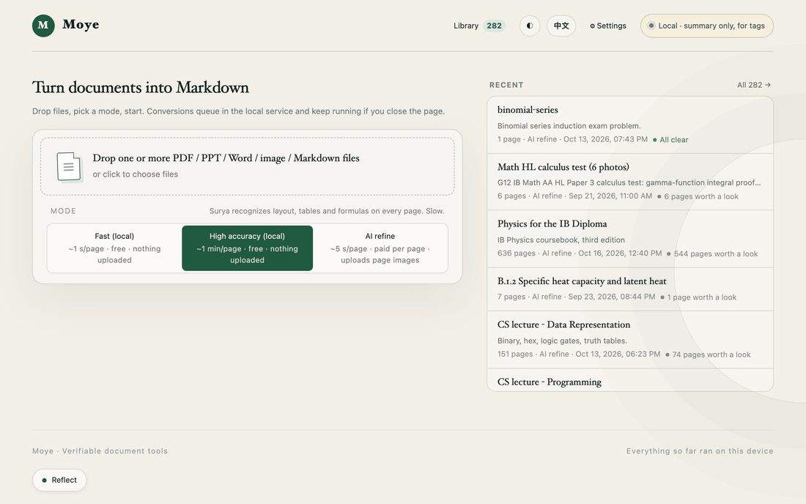
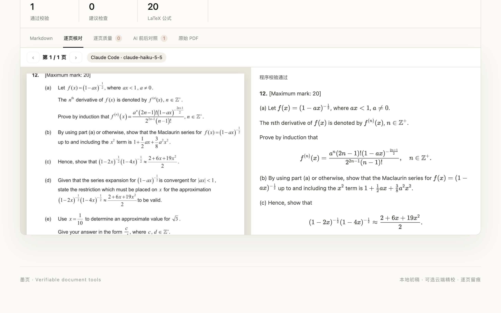
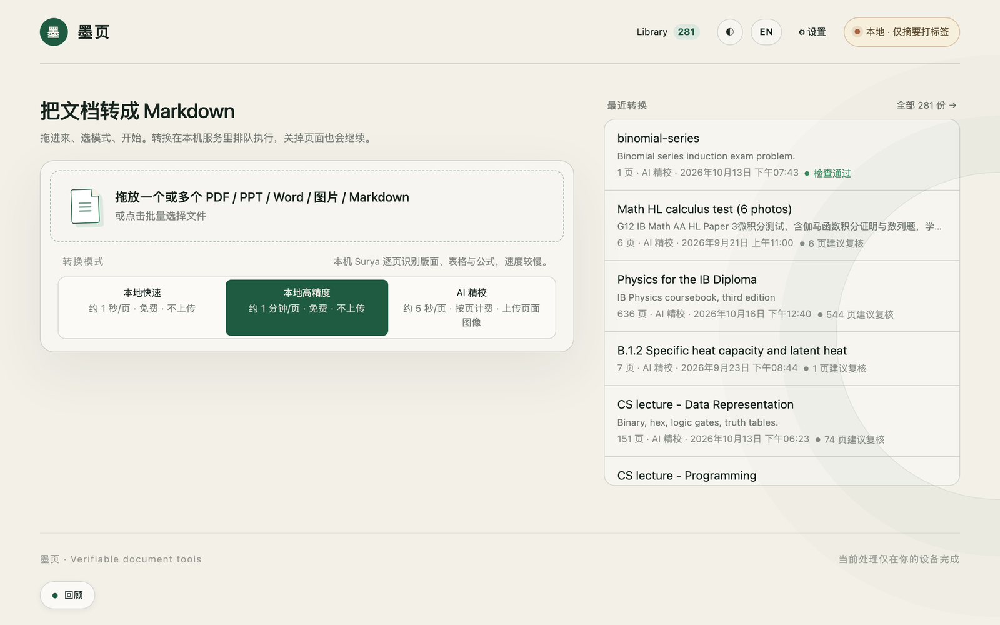

# 墨页 Moye

把教材、作业和 PPT 转成干净、可编辑的 Markdown。

## 为什么做它

我是 Kerwin，一名学生。我的 IB 教材大多是 PDF，里面有很多公式和表格。我试过的 PDF 转换工具只能读 PDF 自带的文字层（公式会变成看不懂的乱码），而且速度很慢，让我很抓狂。

所以我在 2026 年 8 月做了墨页。它按每一页的情况决定怎么处理：有文字层就直接读，没有就交给 OCR（[Surya](https://github.com/VikParuchuri/surya)）；也可以让视觉大模型一页一页地看页面图像，公式输出成 LaTeX。

## 我真的在用它

墨页不是为了展示而包装的项目，是我处理学习资料用的工具。截至 2026 年 10 月 17 日：

- 两个月转换了 225 份文档，共约 6,500 页（重复转换和测试文件不算）
- 处理过的最大文档是一本 912 页的书
- 一次连续处理 355 页课件，每一页都由 AI 识别完成，没有一页回退到文字层

开发时用 Claude Code 作为编程工具。

[English README](./README.md)





## 只读文字层的工具做不到的

|  | 只读文字层的工具（`pdf2md` 等） | 墨页 |
| --- | :---: | :---: |
| 干净的电子版 PDF | ✓ | ✓ |
| 扫描页、纸张照片 | ✗ | ✓ Surya OCR |
| 公式 → LaTeX（`$…$`、`$$…$$`） | ✗ | ✓ |
| 表格 → Markdown 表格 | 看运气 | ✓ 按版面识别 |
| 多栏页面的阅读顺序 | ✗ | ✓ |
| PowerPoint（.ppt/.pptx） | ✗ | ✓ 经 LibreOffice |
| Word（.doc/.docx） | ✗ | ✓ 经 LibreOffice |
| 图片（png/jpg/webp/heic/多页 tiff） | ✗ | ✓ 先包成 PDF，像素无损 |
| 「这张图里没有文字」 | 默默输出空白 | ✓ 模型逐页说明 |
| 700 页、400MB 的书 | 浏览器崩溃（约 10MB 上限） | ✓ 实测过 |
| 转换中途关掉网页 | 任务丢失 | 任务在服务端照跑 |
| 逐页质量报告 | ✗ | ✓ 哪几页要复核、为什么 |
| 视觉模型精校 + 校验 | ✗ | ✓ 本机 Ollama 或 Claude Code，或 Gemini / Kimi / Qwen / OpenRouter，失败自动兜底 |
| 反方向：Markdown → PDF、很多照片 → 一份 PDF | ✗ | ✓ |

## 三种模式

- **本地快速**：只读 PDF 文字层。瞬间完成，文件不出本机，看起来是扫描的页会标出来。
- **本地高精度**：每一页都用 Surya 识别版面、表格和公式。慢一些，仍然完全在本机。
- **AI 精校**：把每页渲染成图片交给视觉模型识别，文字层作提示和回退。每个模型结果都要**过校验**（长度、公式数、选项标签），没通过就回退到本地初稿，而不是把坏结果悄悄交出去。只有这个模式会把页面图像发出本机，而且只发给你配置的服务商。如果某页确实没有文字（照片、插图、空白页），模型会回报 `noText`，这页标成「AI 识别：没有可提取的文字」，而不是记成识别失败。

也可以直接拖入图片（png/jpg/jpeg/webp/bmp/gif/tiff/heic）：先包成 PDF，再走同一条管线。对 AI 精校来说是无损的：页面尺寸按渲染的 `scale=2` 设定，正好还原原始像素。多页 TIFF 变成多页 PDF，HEIC 经 macOS `sips` 转换，长边超过 4000px 的缩到 4000px。注意**本地快速模式读的是文字层，图片没有文字层**，图片请用本地高精度或 AI 精校。

## 安装（macOS）

全新的 Mac 上一条命令（不需要 Homebrew、不需要管理员密码、不需要事先装 Python 或 Node）：

```bash
curl -fsSL https://raw.githubusercontent.com/Kapozux/_pdf-dealer_Moye/main/install.sh | zsh
```

已经下载了项目的话，双击 `一键安装.command`（第一次要右键 → 打开），或在终端运行 `./install.sh`。

安装脚本把 Node 和 Python 装在**项目文件夹里**（`.runtime/`、`.venv/`），装好必需的部分，可选组件逐个询问，最后注册两个开机自启服务（网页 3000、识别服务 8765）并打开 <http://localhost:3000>。可以重复运行，装过的步骤会跳过。

| 组件 | 用途 | 大小 |
|---|---|---|
| Node + npm 依赖 | 全部 | 必需 |
| Python + pypdfium2 + Pillow | AI 精校（渲染页面）、图片 | 必需，约 60MB |
| **Ollama + 视觉模型** | **不用 API Key** 的 AI 精校，页面不上传 | 3～6GB，会询问（默认装） |
| Surya + llama.cpp | 本地高精度模式 | 约 2GB，会询问；llama.cpp 需要 Homebrew |
| LibreOffice | PPT / Word | 约 700MB，会询问 |
| chrome-headless-shell | 下载 PDF、.md 转 PDF | 约 100MB |

跳过的组件随时可以在网页 **设置 → 环境** 里一键补装：那里列出缺什么、影响什么，按钮背后调用的是同一个 `install.sh --only <组件>`，输出记在 `logs/setup.log`。`./uninstall.sh` 撤掉开机自启；删掉项目文件夹就全部清空。

服务装好以后登录 macOS 会自动启动，异常退出会自动恢复。网页没打开时双击 `启动全部服务.command`。日志在 `logs/`。

**AI 精校**可以用本机 [Ollama](https://ollama.com)（免费，页面图像不出本机，一次一页；目前只实测过一次：48GB 的 Mac 上每页 5～15 秒），可以用本机的 [Claude Code](https://claude.com/claude-code)（如果你装了的话：每页一个 `claude -p`，走你自己的订阅，不用 API Key，推荐 Haiku 5.5），也可以用 Gemini、Kimi（Moonshot）、Qwen（百炼）或 OpenRouter 的 API Key。Key 保存在项目目录的 `settings.local.json`（权限 0600、已加入 `.gitignore`），不会以明文发给浏览器，不要把这个文件提交或分享给他人。

本机推荐模型按内存选：16GB 及以上 `qwen3-vl:8b-instruct`，以下 `qwen3-vl:4b-instruct`，可在「设置 → 环境」里一键下载。Ollama 官方模型库在有些网络上几乎下不动（文件放在 Cloudflare R2 上），安装脚本和「环境」页会同时测官方源和[魔搭](https://modelscope.cn)镜像（同一个模型）的速度，自动用快的那个；`MOYE_MODEL_SOURCE=ollama|modelscope` 可以强制指定。

云端模型建议：Kimi 用 `kimi-k2.6`；Qwen 稳定首选 `qwen3.7-plus`，低成本可用 `qwen3.7-flash`，文档 / 表格 / 试卷 / 手写提取可用 `qwen-vl-ocr`。设置页填入 Key 后可以从服务商实时同步可用的视觉模型，也可以直接填新的 Model ID。阿里云百炼的 Key 与 API Base URL 地域必须一致。

<details><summary>手动安装</summary>

需要：Node ≥ 22.13；`.venv/`（或 `../.venv-marker/`、或 `MOYE_VENV`）里有一个装了 `pypdfium2 pillow` 的 Python 3.12 环境；本地高精度另需在该环境装 `surya-ocr`，并装 `llama-server`（`brew install llama.cpp`）；PPT/Word 需要 LibreOffice；本机 AI 需要 Ollama。

```bash
npm install
uv venv .venv --python 3.12 && uv pip install --python .venv/bin/python pypdfium2 pillow
# 可选：uv pip install --python .venv/bin/python surya-ocr && brew install llama.cpp
./安装开机自启.command      # 构建并注册 launchd 服务
```
</details>

## 怎么运作

```
浏览器（3000）  ──提交 / 看进度（SSE）──▶  本机服务（8765）  ──▶  Surya / 视觉模型
React，不含逻辑                             队列 · 管线 · SQLite
```

- **浏览器只是观察者。** 转换全在服务端；关掉网页什么都不影响。
- **任务会持久保存。** 状态在 `data/moye.db`（SQLite），产物在 `data/jobs/<id>/`。长的 AI 任务每页都存档到 `pages.jsonl`，服务重启后从上一页接着跑，不用从头再来。
- **大文档边读边处理，不整本载入。** 页面按 48 页一组、随模型消耗滚动渲染；读文字层放在短命子进程里，pdf.js 处理大书时几 GB 的内存不会留在常驻服务里。一本 698 页、428MB 的教材，内存峰值约 0.8GB。
- **并发靠实测，不靠猜。** 一个 AIMD 节流器（类似 TCP 拥塞控制）给每家服务商一条车道：成功就加速，超时就退让，每页派给空位最多的车道。某家服务商变慢时，流量会自动流向其他家，不用手动配置。
- **AI 模式三层兜底：** 换上游供应商 → 换模型 → 回退到本地初稿。每条失败路径都会记下原因。

代码地图：`local-ocr-server.mjs`（HTTP + 服务商调用）· `server/queue.mjs`（按模式分车道、SSE）· `server/convert.mjs`（管线、校验、闸门）· `server/pacer.mjs`（自适应节流）· `server/jobstore.mjs`（SQLite + 存档）· `app/page.tsx`（整个界面）。

## 输出



- Markdown 预览、复制、下载；一次拖入多份会变成一个「合集」，可以下载成一份 `.md` 或一个 `.zip`。
- 逐页对照模型最终稿和本地初稿。
- 逐页质量清单：用了哪个引擎、公式数 / 选项数、每个需要复核的原因。可导出成 JSON。
- Library 收着转换过的所有东西，可全文搜索，可原地查看原 PDF。重新精校会原地覆盖同一条记录，覆盖前留一份 `result.prev.json` / `document.prev.md` 备份。

## 调参

所有默认值都是在真实批次上实测定的（改之前先看代码里的注释）。

| 变量 | 默认 | 含义 |
| --- | --- | --- |
| `MOYE_AI_JOB_CONCURRENCY` | 1 | AI 模式同时转几份文档（真正的上限是全局请求闸门） |
| `MOYE_AI_PAGE_CONCURRENCY` | 按服务商权重 | 覆盖全局在途请求上限 |
| `MOYE_RENDER_CHUNK_PAGES` | 48 | AI 模式每次 Python 调用渲染几页 |
| `MOYE_PAGE_TIMEOUT_MS` | 30000 | 单次模型调用超时（各服务商可单独设） |
| `MOYE_OPENROUTER_PROVIDERS` | CoreWeave,Parasail,Inceptron,Baidu,Cloudflare | 上游供应商白名单——不指定供应商时实测慢 20 倍 |
| `MOYE_RENDER_CONCURRENCY` | 16 | 同时几个 Python 渲染进程 |

实时诊断：`curl -s http://127.0.0.1:8765/api/debug | python3 -m json.tool`。

## 开发

```bash
npm run dev      # 网页开发（别和后台 3000 端口的网页服务同时跑）
npm run build    # 之后：launchctl kickstart -k gui/$(id -u)/com.kapozux.moye-web
npm test         # 构建 + 渲染测试
npm run lint
```

## 隐私

本地快速和本地高精度模式不会带着你的文档发出任何网络请求。用 Ollama 的 AI 精校，页面图像也不出本机。用 Claude Code 或云端服务商的 AI 精校，只把页面图像和文字层提示发给那一家（Claude Code 发给 Anthropic），别的什么都不发。没有任何东西上传给「我们」——根本没有「我们」。

## 许可

MIT
